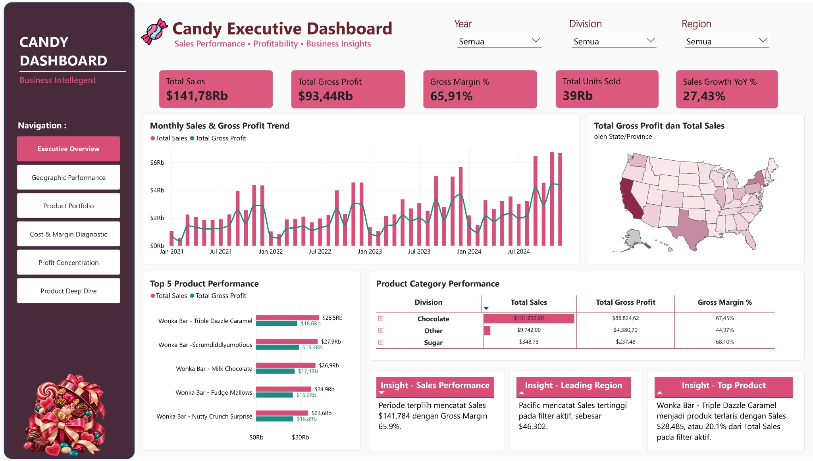
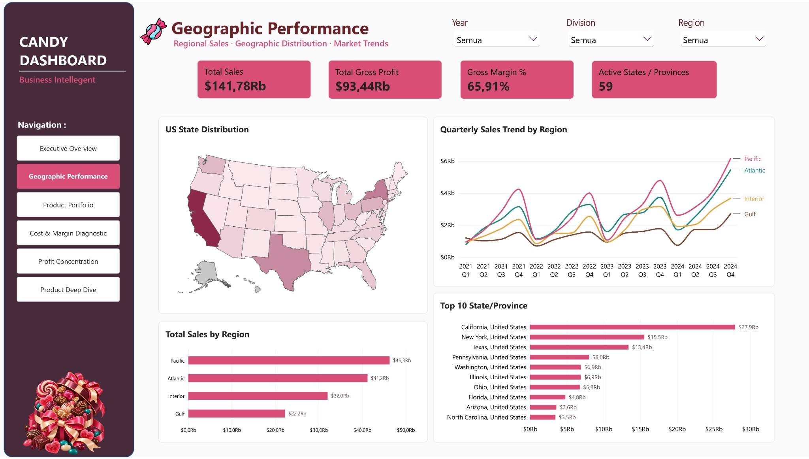
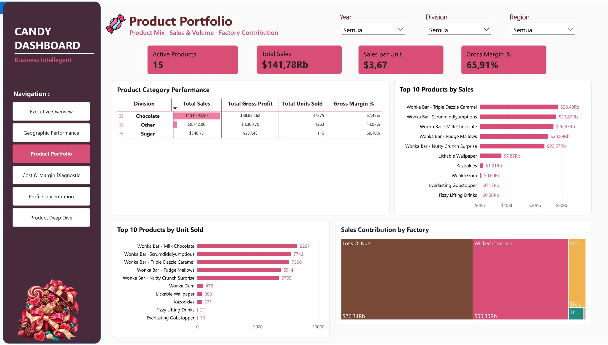
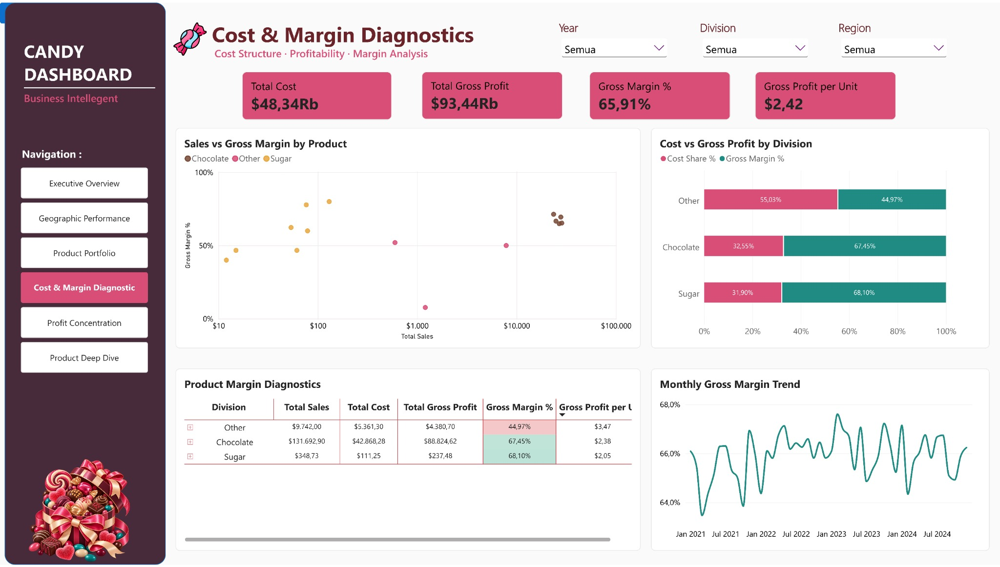
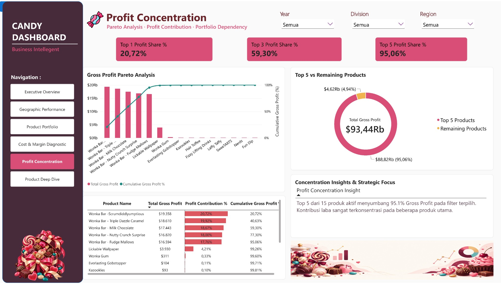
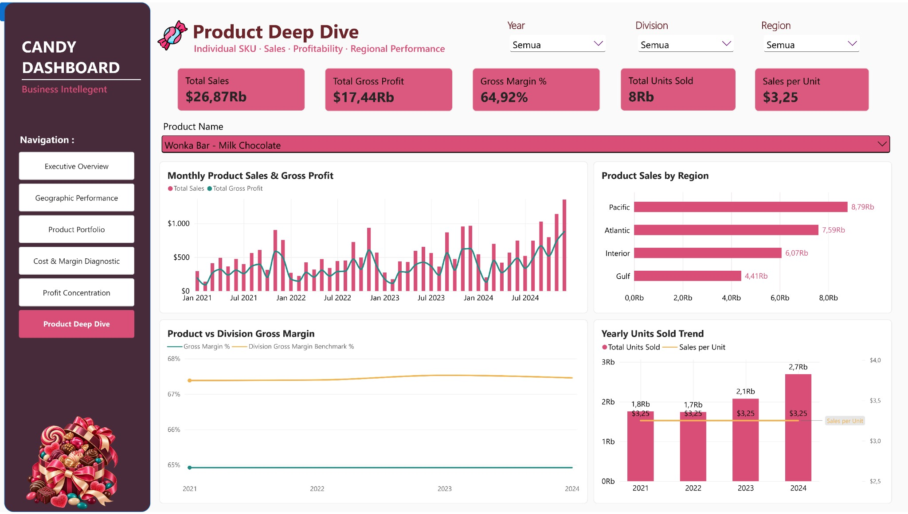

# US Candy Distributor | Sales & Profitability Intelligence

**An end-to-end Power BI portfolio case study** exploring sales performance, geographic distribution, product economics, and profit concentration across a US candy distributor's 2021–2024 sales history.

**Tools:** Power BI Desktop · Power Query · DAX · Data Modeling · Interactive Data Visualization  
**Data source:** [Maven Analytics — US Candy Distributor](https://mavenanalytics.io/data-playground/us-candy-distributor)  



> **Screenshot formatting note:** The report was captured with an Indonesian Power BI locale. `Rb` means *ribu* (thousand) in visual display units; for example, `$141,78Rb` = approximately **US$141.78K**, **not** Indonesian rupiah. Figures in this README use English-number formatting. The screenshots themselves were preserved as captured.

## Executive summary

The distributor recorded **$141,783.63 in sales** and **$93,442.80 in gross profit** over the analysis period, equivalent to a **65.91% gross margin**. Sales grew from **$28,953.55 in 2021** to **$46,968.11 in 2024**, with **27.43% year-over-year growth in 2024 vs. 2023**.

Profitability is highly concentrated: **five of the 15 products contributed $88,824.62, or 95.06%, of total gross profit**. Meanwhile, the **Other** product division had a substantially lower gross margin (**44.97%**) than **Chocolate (67.45%)** and **Sugar (68.10%)**, indicating an opportunity for a closer cost-and-pricing review—not, by itself, proof of poor business performance.

### Key metrics (all dates and divisions)

| Metric | Result | Interpretation |
|---|---:|---|
| Total sales | **$141,783.63** | Sum of sales values |
| Gross profit | **$93,442.80** | Sales less recorded cost |
| Total cost | **$48,340.83** | Recorded product costs |
| Gross margin | **65.91%** | Gross profit / sales |
| Units sold | **38,654** | Sum of units, not number of orders |
| Active products | **15** | Unique products present in sales |
| Sales growth (2024 YoY) | **27.43%** | 2024 compared with 2023 |
| Top 5 gross profit share | **95.06%** | Five highest-profit SKUs / total gross profit |

## The business problem

A high-level revenue total cannot explain whether growth is broad-based, which territories contribute the most, how product margins differ, or how much gross profit depends on a handful of SKUs. This project develops a single interactive report to answer:

1. How did sales, costs, gross profit, and volume evolve from 2021 through 2024?
2. Which regions and states/provinces contributed the most sales?
3. Which products, divisions, and factories drove revenue and volume?
4. Which divisions and products have relatively stronger or weaker gross margins?
5. How concentrated is gross profit among top-performing products?
6. How does an individual product compare with its division and across regions and years?

The goal is **descriptive and diagnostic analysis**, not demand forecasting, causal inference, or optimization of shipping routes.

## Data and analytical approach

The underlying public sample dataset contains sales lines and reference data for products, factories, and geography. The main analytical model uses:

| Table | Role |
|---|---|
| `Candy_Sales` | Fact table of **10,194 sales lines**, including order dates, product keys, geography, sales, units, cost, and gross profit |
| `Candy_Products` | Product dimension: **15 products**, divisions, and associated factories |
| `Candy_Factories` | Factory dimension: **5 factories** |
| `Dim_Date` | DAX calendar dimension derived from **Order Date**, covering **2021–2024** |

Relationships follow single-direction filtering from the dimension tables to sales:

```text
Candy_Factories[Factory]  1 ── * Candy_Products[Factory]
Candy_Products[Product ID] 1 ── * Candy_Sales[Product ID]
Dim_Date[Date]            1 ── * Candy_Sales[Order Date]
```

### Preparation and quality controls

- Corrected locale-sensitive numeric conversion in Power Query, using **Decimal Number / English (United States)** where decimal points had been misinterpreted.
- Reviewed column types and maintained product/customer/geographic identifiers as identifiers rather than numeric measures.
- Used the master `Candy_Products[Division]` to classify products consistently instead of relying on inconsistent Division values in the sales records.
- Anchored time analysis to **Order Date**. `Ship Date` was excluded from transit-time claims because anomalous dates were identified during preparation.
- Kept geographical claims restricted to their supporting data: the US Shape Map is **not** evidence of Canadian state/province coverage.
- Did not include division goals or shipping optimization results as evaluated business outcomes because target-period and shipping-date suitability were not established for those analyses.

For modeling details, measurement definitions, and caveats, see [Model & Data Quality Notes](docs/model_and_quality.md). Representative DAX from the build is in [DAX Reference](docs/dax_reference.md).

## Dashboard walkthrough - six report pages

The report uses consistent **Year, Division, and Region** filters and a sidebar for navigation. The Product Deep Dive adds a product selector for single-SKU analysis.

### 01 - Executive Overview


**Purpose:** Monitor the overall sales and profit picture at a glance.

**Key visuals:** Sales, gross profit, margin, units, and YoY KPI cards; monthly sales versus gross profit; state-level map; top-five product performance; division-level performance matrix; and a set of compact business insights.

**Takeaway:** Revenue increased across the four-year period, with the strongest reported annual sales in **2024**. The five major Wonka Bar products account for most sales and profit, motivating the deeper concentration analysis later in the report.

### 02 - Geographic Performance



**Purpose:** Compare sales performance across US geography and distributor-defined regions.

**Key visuals:** US Shape Map, sales by region, top-ten state/province ranking, quarterly sales trends by region, and geographical KPI cards.

**Takeaway:** **Pacific ($46.30K)** leads regional sales, ahead of **Atlantic ($41.20K)**, **Interior ($32.04K)**, and **Gulf ($22.25K)**. The map shows the US geographic subset; the dashboard's **59 distinct State/Province entries** should not be described as 59 US states.

### 03 - Product Portfolio



**Purpose:** Examine the product mix and identify revenue, volume, and factory concentration.

**Key visuals:** Division performance matrix, top-ten products by sales, top-ten products by units sold, and factory contribution treemap.

**Takeaway:** **Chocolate generated $131,692.90** in sales (approximately **92.88%** of total sales). **Lot's O' Nuts ($76.34K)** and **Wicked Choccy's ($55.35K)** account for most recorded factory-attributed sales. The treemap contains small factory segments that require hover interaction for full details.

### 04 - Cost & Margin Diagnostics



**Purpose:** Explore unit economics and relative gross profitability rather than revenue alone.

**Key visuals:** Scatter plot of sales vs. gross margin on a **logarithmic sales axis**, cost share vs. gross margin by division, margin diagnostics matrix, and monthly gross margin trend.

**Takeaway:** The **Other** division's gross margin was **44.97%**, compared with **67.45% for Chocolate** and **68.10% for Sugar**. This is a signal to examine product-level cost and price structures; the chart does not establish the cause of the difference.

### 05 - Profit Concentration



**Purpose:** Quantify gross profit dependency across products using a Pareto perspective.

**Key visuals:** Top 1 / Top 3 / Top 5 profit share KPI cards, ranked gross profit columns with a cumulative line, Top 5 vs Remaining donut, and a product-level contribution table.

**Takeaway:** The top five products generated **95.06%** of gross profit, while the remaining ten contributed **4.94%**. The cumulative profit curve rises sharply and then flattens. This identifies a concentration exposure worth investigating—not a demonstrated stockout or supplier risk.

### 06 - Product Deep Dive



**Purpose:** Investigate one SKU with filter-aware KPIs and comparison against its division.

**Key visuals:** Selected-product KPIs, monthly sales and gross profit, regional sales, product gross margin vs. division benchmark, and yearly units versus sales per unit.

**Screenshot example:** **Wonka Bar – Milk Chocolate** is selected. It shows about **$26.87K sales**, **$17.44K gross profit**, and **64.92% gross margin**. Its margin is lower than the full Chocolate-division benchmark of approximately **67.45%** over the full period. The comparison is descriptive; it does not establish why the gap exists.

## Findings and business implications

| Evidence | Business interpretation | Recommended next question / action |
|---|---|---|
| Top five SKUs contributed **95.06%** of gross profit | The gross-profit portfolio is concentrated | Monitor the availability and performance of major SKUs; validate supplier and stockout exposure before claiming operational risk |
| **Other** division margin = **44.97%** | Its cost-to-sales ratio is higher than in the other divisions | Examine per-SKU pricing, product costs, and mix rather than applying a blanket price increase |
| Pacific sales = **$46.30K**, highest of four regions | Largest recorded regional sales base | Compare sales with market size, distribution reach, and cost-to-serve before prioritizing geographic investment |
| 2024 sales = **$46.97K** (up **27.43% YoY**) | Sales expanded versus 2023 | Break down growth by product and region; confirm sustainability with additional periods |
| Two leading factories account for roughly **92.88%** of sales | Factory-attributed sales are concentrated | Evaluate factory capacities and supply resilience with operational data not present in this report |

These recommendations are **hypotheses for decision-making**, not proven causal findings.

## Measurement logic

Representative measures include:

```dax
Total Sales = SUM('Candy_Sales'[Sales])

Total Gross Profit = SUM('Candy_Sales'[Gross Profit])

Gross Margin % = DIVIDE([Total Gross Profit], [Total Sales], 0)

Sales per Unit = DIVIDE([Total Sales], [Total Units Sold], 0)

Gross Profit per Unit = DIVIDE([Total Gross Profit], [Total Units Sold])
```

The Pareto visuals use DAX with `ALLSELECTED` to compute product shares in the selected filter context. The division benchmark removes the selected-product filter while retaining the appropriate division, time, and geographical context. See the [DAX Reference](docs/dax_reference.md) for additional examples.

## Scope and limitations

- **Sample data:** This is an independent portfolio exercise using a public dataset, not a commissioned internal company analysis.
- **Gross profit, not net income:** Other operating costs, taxes, and financing are not captured by the gross margin KPI.
- **Date selection:** Sales trends use **Order Date**; shipment-lag and shipping-efficiency conclusions are intentionally excluded.
- **Geographic coverage:** US state maps do not represent Canadian provinces. The distinct State/Province count is not equivalent to a count of US states.
- **Line vs. order grain:** There are **10,194 sales lines**; the project does not equate this count with verified unique customer orders or compute order-based AOV from it.
- **Targets:** The target file did not provide a sufficiently clear comparable period for an evaluated target-attainment KPI in this dashboard.
- **Pareto and benchmarks:** Rankings and measures can change under report filters. The division benchmark is intended to exclude the selected SKU restriction while preserving the relevant division and time context.
- **YoY KPI:** The overview's default **27.43%** refers specifically to **2024 vs. 2023** when the full date history is visible. It should not be interpreted as a 2021–2024 compounded growth rate.
- **No causality or forecasting:** Associations observed here do not establish drivers, demand forecasts, or the effect of prospective actions.

## Repository layout

```text
us-candy-distributor-powerbi/
├── README.md
├── images/
│   ├── 01_Executive_Overview.jpg
│   ├── 02_Geographic_Performance.jpg
│   ├── 03_Product_Portfolio.jpg
│   ├── 04_Cost_Margin_Diagnostics.jpg
│   ├── 05_Profit_Concentration.jpg
│   └── 06_Product_Deep_Dive.jpg
└── docs/
    ├── model_and_quality.md
    └── dax_reference.md
```

**Power BI source file:** Add your saved `Candy_Distributor_BI_Dashboard_v1.0.pbix` to this repository separately if you decide to share the interactive project. The `.pbix` is **not included** in the supplied screenshot/documentation package.

## How to explore the report

1. Open the local `.pbix` in **Power BI Desktop** (when made available by the project owner).
2. Start at **Executive Overview**; use the sidebar to navigate the six report pages.
3. Change **Year**, **Division**, or **Region** to inspect filter-dependent metrics.
4. Visit **Profit Concentration** to assess ranked gross-profit share.
5. In **Product Deep Dive**, choose a specific product to compare sales, volume, margin, and regional performance.

If using only the public repository's screenshots, views are static and slicers are not interactive.

## Attribution

- **Dataset:** Maven Analytics, [US Candy Distributor](https://mavenanalytics.io/data-playground/us-candy-distributor). The dataset page identifies it as **Public Domain**.
- **Dashboard and analysis:** Independent Power BI portfolio project.
- **Visual assets:** Candy-themed illustrative artwork used for dashboard styling; illustrations are decorative, not sales data.

---

*Prepared as a data analytics portfolio case study. Metrics refer to the dataset's 2021–2024 Order Date history unless stated otherwise.*
